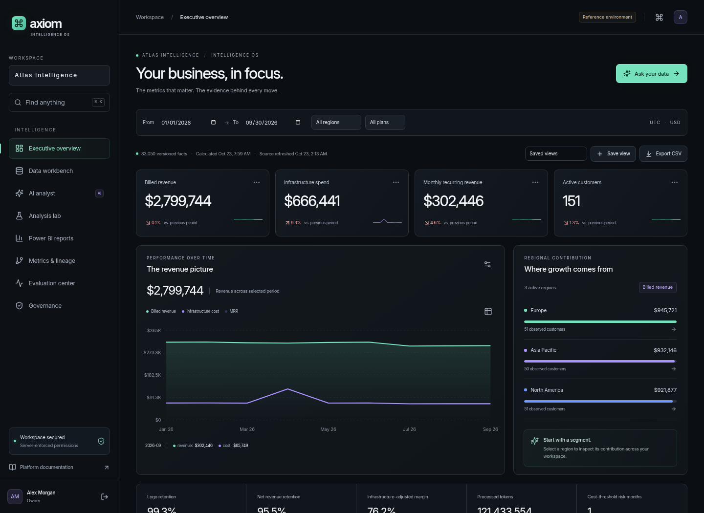

# Axiom Intelligence OS



A server-backed React 19 / Next.js 15 analytics platform with authenticated workspaces, immutable dataset versions, reproducible calculations, an OpenAI analyst adapter, independent benchmark cases, and Power BI Embedded integration.

The original marketing, observability, developer playground, workflow builder and pricing template remain available. Open `/app/` for the new application.

## Run with Docker

Use Node.js 22 LTS and Docker Compose v2:

```sh
npm ci
npm run setup
docker compose up --build -d
```

Open http://localhost:3000/login/ and select a reference account. Setup generates local credentials in an ignored `.env`; it never prints them. The init service applies migrations and generates **249,150 facts across three organizations and 36 months**. First build downloads Python analytical packages and container images.

Local services: web on 3000, PostgreSQL on 5436, Keycloak on 8081, and a durable background worker. Published ports bind to localhost. `AXIOM_DEMO_LOGIN=true` is for the local reference environment only.

For native development alongside containerized PostgreSQL, follow [Onboarding](docs/ONBOARDING.md).

## Working modules

| Module              | Capabilities                                                                                                                                                                                   |
| ------------------- | ---------------------------------------------------------------------------------------------------------------------------------------------------------------------------------------------- |
| Executive overview  | Defined revenue, cost, MRR, customer, retention, NRR, margin and usage metrics; date/segment filters; comparisons; keyboard chart inspection; saved views; CSV                                 |
| Data workbench      | CSV/XLSX/JSON/Parquet imports; asynchronous profiling; quality observations; reviewed cleaning/type corrections; immutable version publication; record previews                                |
| AI analyst          | Natural-language catalog queries; clarification and abstention; query/fact/provenance inspection; follow-ups; uploaded dataset aggregations; saved analyses                                    |
| Analysis lab        | Cohorts, observed funnels, segment contribution, STL anomalies, forecast backtests/intervals, bootstrap comparisons, and explicit scenarios                                                    |
| Metrics and lineage | Versioned definitions, owners, formulas, source-to-metric-to-dashboard edges, uploaded dataset nodes                                                                                           |
| Evaluation center   | 32 reproducible cases, independent reference calculations, critical security overrides, provider/prompt metadata and run comparison                                                            |
| Power BI            | Local preview; real server-authenticated app-owns-data adapter; tenant report mapping; RLS identities; token renewal; supported filters/pages/bookmarks; queued exports and refresh submission |
| Governance          | Role management, shared saved analyses, background job status/cancellation, append-only application audit events                                                                               |

## Two explicit modes

`AXIOM_MODE=demo` uses seeded operational facts and a deterministic question planner. Ingestion, calculations, database authorization, and jobs are real. Uploaded data has its own source/version. The Power BI surface is a labeled local preview.

`AXIOM_MODE=connected` requires real identity/service configuration. The OpenAI adapter requires both API key and explicit model. Power BI requires a mapped Microsoft workspace/profile, reports, RLS identities, credentials and eligible capacity. Failures return errors rather than sample results.

Connected operational dashboards and the statistical lab use a reviewed, canonical fact snapshot published with `npm run facts:import`. The importer validates USD cents, UTC dates, token units and event grains, then atomically activates an immutable workspace version. Source freshness and historical versions remain visible. See [Connected data sources](docs/DATA-SOURCES.md) for the schema and operator setup; upstream vendor extraction and mapping remain deployment-specific.

Without a provisioned source, operational requests fail clearly. Uploaded datasets remain separately queryable in the Analyst using count/sum/average/min/max and an optional grouping column. They do not automatically become SaaS revenue or retention records.

## Verify

```sh
npm run typecheck
npm test
# With .env, migrated/seeded PostgreSQL and a running worker:
npm run test:integration
# With a running local web server and Chromium:
npm run test:e2e
npm run build
```

See [Validation](docs/VALIDATION.md) for actual checks and limitations. A deterministic baseline is not an LLM capability score. Missing provider-cost evidence remains unscored.

## Engineering handoff

[Download the Intelligence OS v2 guide (PDF)](docs/axiom-intelligence-os-guide.pdf?raw=1). This opens the PDF directly, bypassing GitHub's file preview. Its reproducible source is `scripts/build-guide.py`; optional document dependencies are in `docs/requirements-guide.txt`.

- [Onboarding and identity setup](docs/ONBOARDING.md)
- [Connected data sources and snapshot provisioning](docs/DATA-SOURCES.md)
- [Feature status and remaining integration checks](docs/FEATURE-STATUS.md)
- [Architecture and security boundaries](docs/ARCHITECTURE.md)
- [API contracts](docs/API.md)
- [Power BI setup, licensing and troubleshooting](docs/POWER-BI.md)
- [Benchmark definitions and scoring](docs/BENCHMARKS.md)
- [Product layouts and journeys](docs/BLUEPRINT.md)
- [Performance](docs/PERFORMANCE.md) and [accessibility](docs/ACCESSIBILITY.md)
- [Original template guide, v1 PDF](docs/axiom-product-and-engineering-guide.pdf?raw=1): historical frontend edition; this README and v2 documentation describe Intelligence OS.

The existing private Sites preview represents the original static template. Intelligence OS requires the supplied server/worker/database deployment; static hosting cannot execute its backend.
