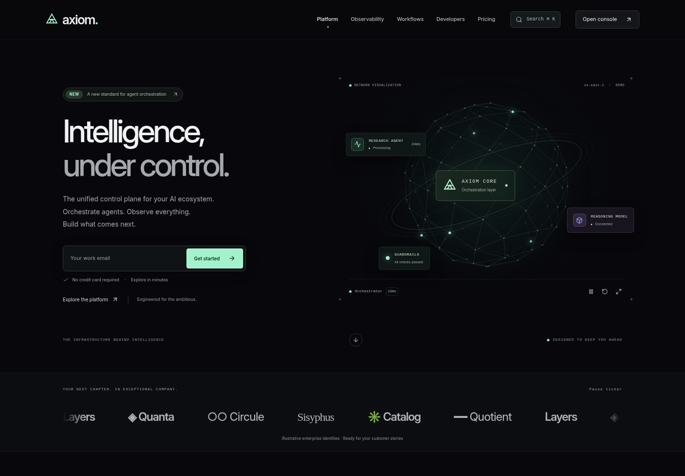

# Axiom · Enterprise AI infrastructure template



[Private live preview](https://axiom-intelligence.atifmahmood131.chatgpt.site)

[Product and engineering guide (PDF)](docs/axiom-product-and-engineering-guide.pdf) - 12 illustrated pages covering features, design, architecture, setup, ROI calculations, and production integration.

A working, configurable React 19 / Next.js 15 App Router starter for an AI operations platform. The interface combines an editorial marketing homepage with observability, developer, workflow, and pricing workspaces. TypeScript, Tailwind CSS 4, Framer Motion, and Lucide provide the component foundation.

## Start in three steps

1. Install Node.js 22 LTS, then run `npm ci` in this directory.
2. Run `npm run dev` and open `http://localhost:3000`.
3. Follow [Onboarding](docs/ONBOARDING.md) to replace the brand, configure workspaces, and connect your services.

```sh
npm run typecheck
npm test
npm run build
```

`npm run build` creates the static deployment in `out/`. Serve that directory through a static web host with directory-index support. The included configuration uses trailing slashes, so `/observability/` resolves to `/observability/index.html`.

## Included experiences

| Route | Working interactions |
| --- | --- |
| `/` | Animated spatial network, validated demo request, expandable fictional case studies, product bento previews |
| `/observability/` | Range selection, keyboard-inspectable multi-series chart, throughput steps, model drift, CSV export, searchable execution traces with routing and cost details |
| `/developers/` | Python, cURL, Go, and Node.js snippets; configurable model, prompt, and temperature; simulated response/event log; tenant-scoped demo key create, reveal, copy, and revoke |
| `/workflows/` | Three starter blueprints, draggable/keyboard-movable nodes, connections, configuration, cycle and run validation, undo/redo, JSON import/export, local save/load, and a simulation inspector |
| `/pricing/` | Monthly/annual plans, feature comparison, configurable SLA brief export, ROI workload presets, editable rates, migration/payback calculations, scenario comparison, and CSV export |
| `/docs/` | Quick start, platform guide, configuration map, production boundaries, and deployment guidance |

The shared command palette opens with Cmd/Ctrl+K. Search destinations, move with arrow keys, and press Enter to navigate. The homepage network includes node inspection, pause, reset, and expanded views; the lead flow can download a local JSON workspace brief.

Atlas and Helix are demo workspaces. Workspace-scoped browser state demonstrates the product interaction model. It does **not** provide authentication, authorization, or tenant isolation. All operational metrics, customer stories, savings, and credentials are examples. The demo request confirms a local interaction; it does not submit contact information to a server.

## Package map

```text
app/                 App Router pages and global visual tokens
components/          Shared shell, command palette, marketing, and operational UI
public/fonts/        Self-hosted Inter variable font and its license
lib/config.ts        Brand, navigation, and demo workspace configuration
lib/roi.ts           Pure cost-estimation model
lib/workflow.ts      Workflow data types and graph rules
tests/               Domain regression tests
docs/                Product blueprint and engineering handoff
next.config.ts       Static-export configuration
.env.example         Documented integration placeholders
```

## Read the handoff

- [Blueprint and user journeys](docs/BLUEPRINT.md): layouts, block specifications, interaction states, and design tokens.
- [Onboarding](docs/ONBOARDING.md): first-run instructions and customization sequence.
- [Architecture](docs/ARCHITECTURE.md): component boundaries, adapter contracts, and a production tenant-isolation design.
- [Accessibility](docs/ACCESSIBILITY.md): WCAG 2.2 AA implementation intent and verification procedure.
- [Performance](docs/PERFORMANCE.md): budgets, measurement conditions, and release checks.
- [Validation record](docs/VALIDATION.md): completed checks, browser journeys, and verification limits.

The components are a runnable frontend foundation. Production use requires your identity provider, server-side authorization, persistent storage, telemetry adapters, billing, and lead intake. The accessibility design is not a certification, and the sub-500 ms delivery target is a performance budget rather than a measured guarantee.

## Technical references

- [Next.js static exports](https://nextjs.org/docs/app/guides/static-exports)
- [Tailwind CSS with Next.js](https://tailwindcss.com/docs/installation/framework-guides/nextjs)
- [W3C WCAG 2.2 quick reference](https://www.w3.org/WAI/WCAG22/quickref/)
