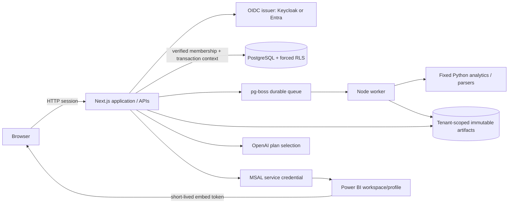

# Intelligence OS architecture

## Runtime and boundaries

Next.js 15 App Router uses `output: standalone`. Public template routes remain accessible; protected `/app/[workspaceId]/...` pages resolve sessions and memberships on the server. Client workspace selection can only choose a returned authorized membership.

The shared TypeScript contracts describe metrics, query plans, datasets, analyst results, evaluation runs, reports and jobs. Feature components consume the same versioned APIs. Business calculation code is independent of presentation.

PostgreSQL stores users, sessions, OIDC transactions, memberships, JSON resources, immutable fact rows, audit events and jobs. JSON resources are bounded to 8 MiB; originals and canonical Parquet files live in tenant-scoped object storage on a shared volume.

## Authorization

The runtime `axiom_app` role is not an owner, superuser or BYPASSRLS role. `withWorkspace` starts a transaction, sets user/workspace context, reloads membership from PostgreSQL, installs the actual role and applies statement/lock/work-memory limits. Read-only analytical operations switch to `axiom_reader`. Pool connections roll back on failure and reset transaction-local context.

Workspace tables have FORCE ROW LEVEL SECURITY. Viewer hints cannot grant analyst privileges. Resource writes and deletions have separate write policies; audit events cannot be updated/deleted by the runtime role. API role checks complement database policies. Origin checks protect browser mutations.

The independently credentialed job role manages the `pgboss` schema. Job messages carry only internal identifiers; each execution reloads application membership, uses the same scoped services, polls cancellation and rechecks access during progress/publication. Results require authorized retrieval. A role revoked mid-operation may prevent the original actor from updating its final job status; operations staff must reconcile stale job records with queue history. Revocation still prevents data publication/access.

## Data versions

Uploads are bounded, hashed and stored under generated identifiers. Fixed Python code validates dimensions, decoded size, macro/formula hazards, schema and quality observations. Profiling writes canonical Parquet. Reviewed transformations publish a new resource/version with its parent hash and complete recipe. Failed imports do not replace ready versions.

Uploaded datasets support explicit safe aggregate plans with optional grouping. PostgreSQL operational metrics have a distinct SaaS fact model. Connected canonical snapshots are installed transactionally by an isolated operator credential; the application role cannot write fact rows or change active-source/snapshot metadata. Each calculation pins one immutable version. See [Data sources](DATA-SOURCES.md). There is no automatic currency conversion or automatic mapping of arbitrary files into financial metrics.

## Query execution

The model returns metric IDs, dimensions and filters. A deterministic compiler generates parameterized PostgreSQL SQL; an AST validator rejects writes, multiple statements, unknown relations/functions and system catalogs. Reference financial facts are aggregated without multiplying invoice/cost grains. Retention uses observed opening/closing customer snapshots.

Uploaded queries are compiled from the authorized dataset catalog into a single SELECT over `selected_dataset`. A bounded DuckDB process registers the selected canonical frame, disables external access, and executes only the compiled query. Raw SQL and arbitrary Python expressions are not accepted by any API.

Limits include upload/decoded size, row count, permitted relations, result rows, statements, subprocess output, execution time and container resources. No PostgreSQL scanned-byte counter or planner-estimate budget is implemented. See PERFORMANCE.md.

## Analytical methods and AI

Python implements reviewed deterministic methods with pandas/numpy, statsmodels and scipy. Forecasts use six rolling holdouts, compare seasonal naive with additive damped exponential smoothing, and show approximate RMSE-based intervals. Insufficient history and missing months do not silently become valid forecasts. Anomaly detection combines robust STL residual scores with an independent Theil–Sen trend/monthly-median guard, preventing a fitted seasonal component from hiding isolated spikes.

OpenAI receives the question, authorized schema/catalog and prior validated plan, not unrestricted uploaded records. Responses use strict JSON output and are validated again. The query engine produces all numeric facts. The explanation exposes limitations and does not claim causation. Conversations pin dataset versions and belong to their author; saved analyses are workspace-visible.

## Integrations

Power BI mappings are installed by a trusted provisioning operator, not a viewer/analyst generic-resource API. A profile/workspace pair cannot be reused across organizations through the provisioning script. Microsoft IDs and RLS identities come from that mapping, never browser request fields. Entra tokens stay on the server; only scoped embed configuration reaches the client.

Demo and connected modes are deployment configuration. Each source identifies seeded/uploaded/connected origin. Service failure never selects a demo adapter implicitly.

## Deployment

Docker Compose contains PostgreSQL, optional local Keycloak, init, web and worker processes. Node runs as a non-root user in application containers. Initialization alone receives database administration credentials. Web and worker share the artifact volume, so the supplied storage adapter is a single-host reference deployment. Horizontal/multi-region deployment needs an object-store adapter and a production identity/database setup.

CSV downloads reauthorize the current user and record bounded snapshot metadata. Power BI artifacts additionally require the original export creator and an unchanged server-derived report/model/effective-identity fingerprint; retries cannot reuse exports under a changed scope. Changes within a remote semantic model that do not alter the application mapping still require Microsoft-side verification.
