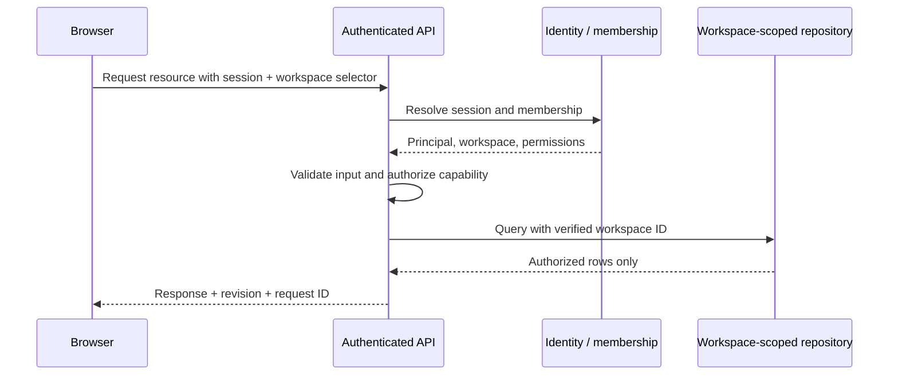

# Engineering architecture and integration contracts

## What runs today

The reference is a static-exported Next.js 15 App Router application using React 19, strict TypeScript, Tailwind CSS 4, Framer Motion, and Lucide icons. Server-rendered route entry points compose client components for interaction. `app/layout.tsx` owns the shared shell and `WorkspaceProvider`.

The delivered scope is a working frontend and domain-model foundation. It contains no identity provider, database, telemetry collector, payment processor, agent execution service, or credential-issuing backend. Simulated metrics and local interactions are visibly identified. The environment variables below are integration proposals, not connected functionality.

| Layer | Files | Responsibility |
| --- | --- | --- |
| Routes | `app/**/page.tsx` | Route metadata and page composition |
| Layout | `app/layout.tsx`, `components/site-shell.tsx` | Navigation, landmarks, shared workspace context |
| Global navigation | `components/command-palette.tsx` | Search, keyboard shortcuts, native-dialog routing |
| Identity preview | `lib/config.ts`, `components/workspace-provider.tsx` | Two demo workspaces and local selection |
| Marketing | Homepage and lead components | Product narrative, illustrative proof, validated local brief |
| Operations | `components/observability.tsx`, developer components | Simulated telemetry, SDK examples, local key lifecycle |
| Workflow domain | `lib/workflow.ts` | Graph types, edge validation, topological ordering, safe restoration |
| Workflow interface | `components/workflow-builder.tsx` | Three templates, selection, movement, configuration, connections, undo/redo, validated import/export, local save, simulated run inspector |
| Commercial domain | `lib/roi.ts` | Bounded inputs, configurable rates, cent-rounded costs, signed savings, migration/payback, reproducible CSV export |
| Commercial interface | `components/pricing.tsx` | Billing period, comparison, configurable SLA brief, scenario presets/comparison, live calculator |
| Quality | `tests/*.test.ts`, this documentation | Domain checks and manual release procedures |

`siteConfig.demoMode` documents the intended template mode; it does not automatically select a production adapter or enable a backend. Brand display strings also exist in the shared shell and marketing components. When converting this into a white-label package, centralize those display strings and replace fixture providers explicitly.

Feature components own transient presentation state. Pure functions in `lib/` own calculations and graph rules; they can be reused and revalidated behind an API. New business rules should not live only in event handlers.

## Rendering and storage

`next.config.ts` uses `output: 'export'`, `trailingSlash: true`, and unoptimized images. `npm run build` emits static files under `out/`; it does not provision hosting. Static export excludes request-time route handlers, server sessions, and database queries. A full SaaS deployment needs an authenticated external service or a Next.js server runtime after removing static export.

The browser initially renders the default demo workspace, then restores a recognized selection from `localStorage`. Workspace-specific graph/key storage illustrates partitioning. Browser storage is mutable by the visitor, may be unavailable, is device-local, and is unsuitable for confidential information. It does not synchronize users or prevent access between organizations. A real application should resolve the authorized workspace before rendering private data and invalidate or partition query caches when it changes.

Use stable persisted schema versions. Validate restored data before displaying it, preserve a recoverable state on storage failure, and offer explicit migrations when changing a graph schema. Do not persist customer prompts or execution secrets in browser state.

## Production tenant boundary

The selected workspace ID is a user-interface hint. A server must independently authenticate the principal, verify membership and the requested capability, and scope every database operation. An untrusted body or header cannot grant access to a tenant.



Recommended capabilities are `telemetry:read`, `workflow:read`, `workflow:write`, `workflow:execute`, `keys:read`, `keys:write`, and `billing:manage`. Map roles to capabilities on the server. Hiding a button improves clarity; it does not enforce a permission.

An authenticated endpoint might use the following pattern. These functions are integration interfaces; they are not supplied authentication code.

```ts
// app/api/workspaces/[workspaceId]/workflows/[workflowId]/route.ts
// Requires a server deployment, a real session implementation, and repository.
import { parseWorkflow } from '@/lib/workflow';

export async function PUT(request: Request, context: {
  params: Promise<{ workspaceId: string; workflowId: string }>;
}) {
  const { workspaceId, workflowId } = await context.params;
  const principal = await requireSession(request); // Reject expired/invalid sessions.
  const membership = await requireCapability(principal, workspaceId, 'workflow:write');
  await verifyRequestOrigin(request); // For cookie authentication; implement CSRF protection.
  const body = await readLimitedJson(request, 64_000); // Reject oversized bodies.
  const graph = parseWorkflow(JSON.stringify(body.graph));
  if (!graph) return Response.json({ code: 'invalid_workflow' }, { status: 422 });
  if (!Number.isSafeInteger(body.revision) || body.revision < 0) {
    return Response.json({ code: 'invalid_revision' }, { status: 422 });
  }
  const saved = await workflowRepository.update({
    workspaceId: membership.workspaceId,
    workflowId,
    expectedRevision: body.revision,
    graph,
    actorId: principal.id,
  });
  // Repository enforces workspace scoping and detects revision conflicts atomically.
  return Response.json(saved, { headers: { 'Cache-Control': 'private, no-store' } });
}
```

Map errors to a consistent response: `401` for an absent/invalid session, `403` or enumeration-safe `404` for denied resources, `409` for a revision conflict, `422` for schema violations, `429` for a rate limit, and `503` for a retryable service failure. Never return service credentials or stack traces to the browser.

## Suggested persistence schema

The following PostgreSQL sketch illustrates tenant scoping, not a completed migration:

```sql
create table workspaces (
  id uuid primary key,
  name text not null,
  region text not null
);

create table memberships (
  workspace_id uuid not null references workspaces(id),
  user_id uuid not null,
  role text not null check (role in ('viewer', 'developer', 'admin', 'owner')),
  primary key (workspace_id, user_id)
);

create table workflows (
  workspace_id uuid not null references workspaces(id),
  id uuid not null,
  name text not null,
  graph jsonb not null,
  revision bigint not null default 0,
  updated_at timestamptz not null default now(),
  primary key (workspace_id, id)
);

create table api_keys (
  workspace_id uuid not null references workspaces(id),
  id uuid not null,
  label text not null,
  prefix text not null,
  secret_hash text not null,
  scopes text[] not null,
  expires_at timestamptz,
  revoked_at timestamptz,
  created_at timestamptz not null default now(),
  primary key (workspace_id, id)
);

alter table workflows enable row level security;
alter table workflows force row level security;
create policy workflows_workspace_scope on workflows
  using (workspace_id = nullif(current_setting('app.workspace_id', true), '')::uuid)
  with check (workspace_id = nullif(current_setting('app.workspace_id', true), '')::uuid);
```

Set `app.workspace_id` with a transaction-local parameter only after membership verification. Run application queries as a role without `BYPASSRLS` or superuser privileges. Do not expose that connection to browsers. Apply equivalent policies to other tenant tables and composite tenant/resource foreign keys to dependent rows. RLS supplements authorization; the application still enforces capability-level actions. Test connection-pool reuse and cross-workspace reads, writes, exports, and execution requests.

Store append-only audit events separately with actor, workspace, action, resource, request ID, outcome, and timestamp. Exclude full API secrets, unnecessary personal information, and unrestricted prompt payloads. Select retention and data residency rules with the actual customer and hosting region.

## Adapter contracts

Extract the following contracts into a server/shared package when adding real services. A `workspaceId` parameter is useful for routing and cache keys, but each implementation must authenticate and authorize it.

```ts
import type { Workflow } from '@/lib/workflow';

type RequestOptions = { signal?: AbortSignal };
type TelemetryBucket = {
  at: string; // ISO 8601 UTC timestamp.
  requests: number;
  latencyP50Ms: number | null; // Absence is not zero latency.
  tokensPerMinute: number | null;
};
type TelemetryResult = {
  workspaceId: string;
  from: string;
  to: string;
  bucketSeconds: number;
  collectedAt: string;
  partial: boolean;
  buckets: TelemetryBucket[];
};
type SavedWorkflow = {
  id: string;
  workspaceId: string;
  revision: number;
  graph: Workflow;
  updatedAt: string;
};
type KeySummary = {
  id: string;
  label: string;
  prefix: string;
  scopes: string[];
  createdAt: string;
  expiresAt: string | null;
  revokedAt: string | null;
};

interface PlatformAdapter {
  telemetry(workspaceId: string, range: { from: string; to: string }, options?: RequestOptions): Promise<TelemetryResult>;
  workflow(workspaceId: string, id: string, options?: RequestOptions): Promise<SavedWorkflow>;
  saveWorkflow(workspaceId: string, id: string, expectedRevision: number, graph: Workflow): Promise<SavedWorkflow>;
  listKeys(workspaceId: string, options?: RequestOptions): Promise<KeySummary[]>;
  issueKey(workspaceId: string, input: { label: string; scopes: string[] }): Promise<{ key: KeySummary; secretOnce: string }>;
  revokeKey(workspaceId: string, id: string): Promise<void>;
}
```

A query key must include workspace, resource, range, and filters. Abort outstanding requests when those inputs change and ignore stale responses. Apply server-side range and bucket limits. Preserve raw units in contracts; formatting, compact notation, and locale belong in presentation. Do not average per-bucket percentiles to manufacture an aggregate percentile: request the aggregate from the telemetry provider.

## Endpoint map and error states

| Endpoint proposal | Authorization | UI success state | Required alternatives |
| --- | --- | --- | --- |
| `GET /api/workspaces/:id/telemetry` | `telemetry:read` | Labeled time buckets with collection time | Empty window, partial series, stale data, provider failure |
| `GET /api/workspaces/:id/workflows/:workflowId` | `workflow:read` | Validated definition and revision | Not found, denied, incompatible schema |
| `PUT /api/workspaces/:id/workflows/:workflowId` | `workflow:write` | New revision saved | Invalid DAG, conflict, retryable failure |
| `POST /api/workspaces/:id/runs` | `workflow:execute` | Accepted run ID, then streamed status | Quota, policy denial, cancellation, partial execution |
| `POST /api/workspaces/:id/keys` | `keys:write` | Secret shown once with copy confirmation | Invalid scope, insufficient role, key limit |
| `DELETE /api/workspaces/:id/keys/:keyId` | `keys:write` | Revoked summary | Already revoked, denied, temporary failure |
| `POST /api/leads` | Public, abuse-controlled | Server-confirmed receipt | Validation, rate limit, CRM unavailability |
| `POST /api/workspaces/:id/billing/session` | `billing:manage` | Verified provider redirect | Entitlement conflict, unsupported plan, provider failure |

Lead ingestion must validate server-side, apply abuse controls, collect only needed fields, and return an honest delivery status. A CRM write should use a queue with idempotency and retry handling. Payment entitlement changes should be driven by verified, deduplicated provider events; a browser success URL is not proof of payment.

## Workflow execution design

The shipped `Workflow` schema has `version: 1`, at most 12 nodes, and directed edges. `connectionError` rejects unknown endpoints, self-links, duplicates, and cycles; `parseWorkflow` checks shape and bounds; `executionOrder` supplies a stable dependency order for the simulation. The production server must repeat those checks and validate model names, tool access, instructions, and any added configuration against an allowlist.

A real executor needs immutable workflow revisions, per-run IDs, per-node timeouts, bounded retries, concurrency limits, tenant budgets, cancellation, human approval gates where appropriate, and idempotency for external side effects. Keep credentials in a server-side vault and refer to them by authorized connection IDs. A frontend simulated run does not invoke an LLM or prove an agent's output quality.

Suggested event envelope:

```ts
type RunEvent = {
  eventId: string;
  runId: string;
  workflowRevision: number;
  sequence: number;
  occurredAt: string;
  nodeId?: string;
  status: 'queued' | 'running' | 'succeeded' | 'failed' | 'cancelled';
  tokenUsage?: { input: number; output: number };
  error?: { code: string; retryable: boolean };
};
```

For SSE or WebSocket updates, authenticate the connection, authorize the run, handle reconnects using event IDs, and deduplicate events. Keep executable content and user-provided text escaped; do not inject logs as HTML.

## ROI model and commercial boundaries

`calculateROI` is deterministic and uses monthly USD assumptions. It rounds each cost category to integer cents before summing, then calculates signed savings. Annual savings equal twelve identical months. A zero traditional baseline yields a `null` savings percentage, not infinity. Volume and agent counts are normalized to bounded whole values.

Default rates are examples. Labor, migrations, model-provider charges, tax, regional differences, contract discounts, growth, and financing effects are not modeled. Pricing billing-period toggles and ROI assumptions are distinct concepts; do not imply that the calculator derives an actual quote from the plan cards. A production pricing service should return a versioned rate card and a validity period.

## Configuration hooks

| Configuration | Current hook | Production extension |
| --- | --- | --- |
| Brand and navigation | `siteConfig` in `lib/config.ts` | Validated content configuration or CMS |
| Workspace labels and regions | `tenants` in `lib/config.ts` | Authorized workspace API and identity session |
| Theme and motion | Global and component CSS | Shared tokens and explicit reduced-motion behavior |
| ROI rates and bounds | `defaultROIAssumptions`, `roiLimits` | Versioned currency-aware rate service |
| Node catalog | `nodeDefinitions` | Schema-validated allowed tools and model capabilities |
| Workflow validation | `parseWorkflow`, `connectionError` | Shared rules plus server-side policy checks |
| Lead conversion | Lead-dialog component | Validated endpoint and delivery state |
| Telemetry data | Observability sample generator | Bounded authenticated telemetry adapter |

## Release and observability

Build and test the exact revision being released. Configure error reporting with source maps kept private, availability checks, rate-limit metrics, dependency scanning, secret rotation, backup/restore tests, and ownership for failed leads or executions. Use request IDs to correlate browser errors with server logs without exposing private data.

No deployment, service account, production certification, or measured SLA is implied by this package. Record actual results using the procedures in [Accessibility](ACCESSIBILITY.md) and [Performance](PERFORMANCE.md).

## Primary implementation references

- [Next.js static-export behavior and limitations](https://nextjs.org/docs/app/guides/static-exports)
- [Tailwind CSS 4 with Next.js](https://tailwindcss.com/docs/installation/framework-guides/nextjs)
